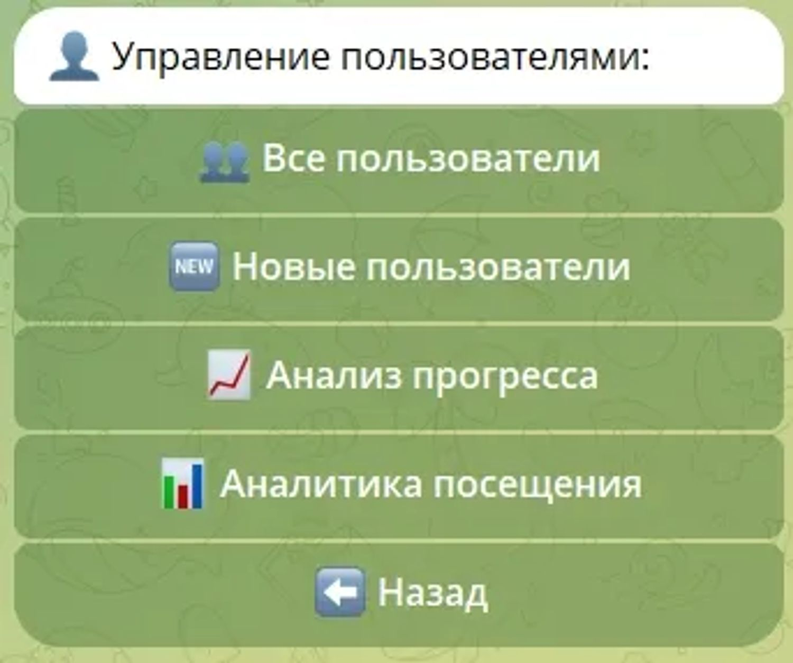
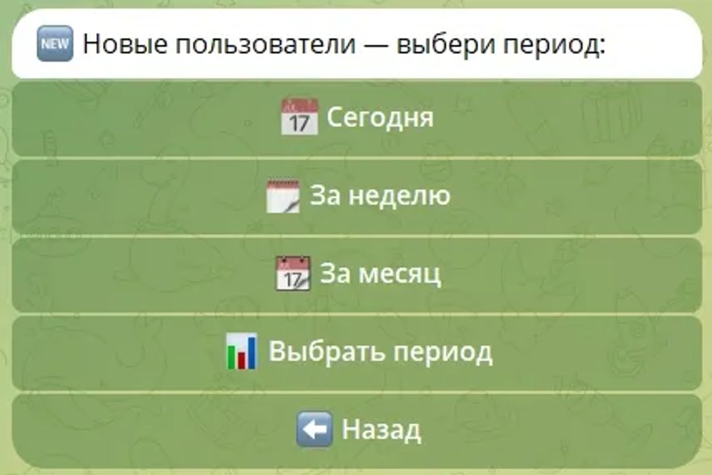
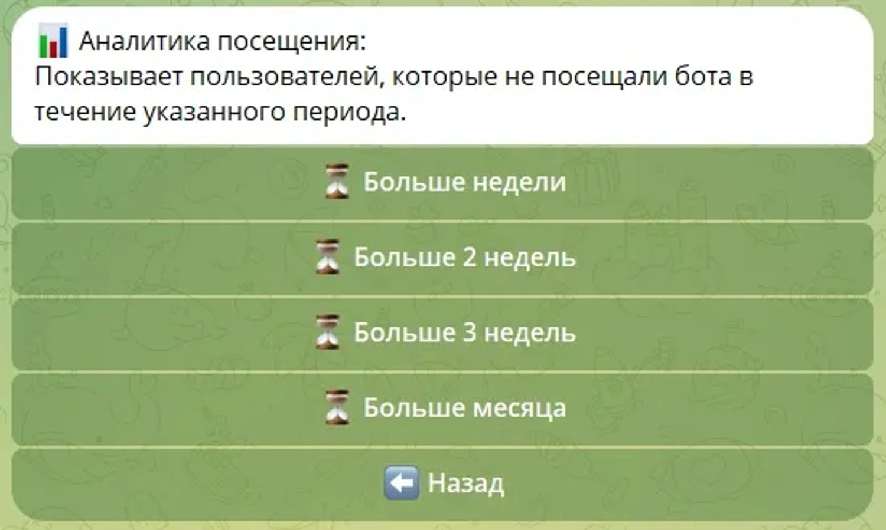

# TGTeacher

Telegram-бот для изучения английского языка (русскоязычный интерфейс) с системой прогресса, многоэтапным обучением и подписочной моделью.

### Возможности:
- Обучение по этапам с сохранением прогресса
- Работа с лексическими группами
- Админ-панель (управление контентом и пользователями)
- Интеграция платежей (YooKassa)
- PostgreSQL для хранения данных

### Стек:
Python, python-telegram-bot, PostgreSQL, Docker

Проект реализует full-cycle разработку: от архитектуры до деплоя и поддержки.


## Скриншоты

### Главное меню
Стартовый экран бота: навигация по обучению, выбор групп слов, прогресс, подписка (ЮKassa).  
Админ-панель доступна только администраторам.


---

### Админ-панель
Центральное управление системой: пользователи, группы слов, рассылки, тарифы подписки и мониторинг состояния бота.


---

### Пользователи
Управление пользователями: прогресс, подписки, персональные рассылки, анализ активности и экспорт данных в Excel.


---

### Новые пользователи
Аналитика новых пользователей по периодам с возможностью выгрузки в Excel.


---

### Неактивные пользователи
Список пользователей, давно не заходивших в бота.


---

### Состояние системы
Мониторинг сервера и бота: логи, статус, снимки системы каждые 5 минут, диагностика состояния.


---

### Подписки
Управление подписками: тарифы, массовое продление, история платежей, интеграция YooKassa.


### Архитектура
Проект разделён на слои: handlers, services, repositories (DB), utils.
Это позволяет масштабировать функциональность и поддерживать код.

## Актуальная структура проекта

```text
TGTeacher/
├─ bot/
│  ├─ main.py                       # Точка входа (оставлена совместимость)
│  ├─ .env.example
│  ├─ admins.txt
│  ├─ help_questions_index.json
│  ├─ exports/
│  ├─ scripts/
│  │  ├─ add_test_users.py
│  │  ├─ seed_payments.py
│  │  └─ clear_families.py
│  └─ tgteacher_bot/
│     ├─ core/                      # app, paths, базовая конфигурация запуска
│     ├─ db/                        # pool + репозитории БД
│     ├─ handlers/
│     │  ├─ user/                   # пользовательские хендлеры и stage_*
│     │  └─ admin/                  # админ-хендлеры
│     ├─ services/
│     │  ├─ payments/               # платежи/подписки
│     │  ├─ exports/                # экспорт/загрузка групп слов
│     │  └─ legacy/                 # служебные фоновые задачи/снапшоты
│     └─ utils/                     # общие утилиты
├─ families/                        # Контент групп слов (txt + media)
├─ requirements.txt
├─ Dockerfile
└─ docker-compose.yml
```

## Требования

- Python 3.10+ (рекомендуется 3.11/3.12)
- PostgreSQL 14+
- `pip`
- (опционально) Docker + Docker Compose

## Локальный запуск

1. Создать виртуальное окружение:
   - `python -m venv .venv`
   - Windows: `.venv\\Scripts\\activate`
2. Установить зависимости:
   - `pip install -r requirements.txt`
3. Подготовить файл переменных окружения:
   - создать `bot/.env` на основе `bot/.env.example`
4. Обеспечить доступность PostgreSQL и наличие базы данных (по умолчанию `tgteacher`).
5. Запустить приложение:
   - `python bot/main.py`

## Переменные окружения

Основные:

- `BOT_TOKEN` — токен Telegram-бота (обязательно).
- `HELP_QUESTIONS_GROUP_ID` — идентификатор группы (chat_id) для пересылки вопросов из раздела помощи (опционально).

Параметры БД:

- `POSTGRES_USER` (default: `postgres`)
- `POSTGRES_PASSWORD` (default: пусто/или задан в окружении)
- `POSTGRES_DB` (default: `tgteacher`)
- `POSTGRES_HOST` (default: `127.0.0.1`)
- `POSTGRES_PORT` (default: `5432`)

## Запуск через Docker

1. Подготовить файл `.env` в корне проекта (как минимум `BOT_TOKEN`; при необходимости — параметры БД).
2. Выполнить запуск:
   - `docker compose up --build`

Сервисы:

- `db` — PostgreSQL 16.
- `bot` — контейнер приложения, запускает `python bot/main.py`.

## Проверка, что всё работает

- Проверка компиляции:
  - `python -m compileall bot`
- Проверка импорта entrypoint:
  - `python -c "import sys; sys.path.insert(0, 'bot'); import main"`

При возникновении `ModuleNotFoundError` (например, `pyzipper`) необходимо установить зависимости в текущем окружении: `pip install -r requirements.txt`.

## Английский учебный контент

- Этап 5: ввод слова или выражения без обязательного артикля. Регистр, лишние пробелы и типографские апострофы не влияют на проверку.
- Варианты с корректными артиклями, британское/американское написание и другие допустимые формы задаются через `#ALTERNATIVES` (разделитель `;`). Неверные артикли и опечатки не принимаются автоматически.
- Этап 8: число пропусков `___` должно совпадать с количеством ответов.
- `families/family_example.txt` — английский шаблон; блоки с картинкой и аудио раскомментируются при наличии соответствующих файлов.
- Демонстрационная группа Fruits & Vegetables содержит текстовые этапы 1–4 и 8. Картинки и аудио пока не включены.

## Тесты

Запуск регрессионных тестов без Telegram, PostgreSQL и API-ключей:

```bash
python -m unittest discover -s tests -v
```

## Данные и контент

- Папка `families/` содержит учебный контент и медиа.
- Runtime-данные:
  - `bot/exports/` — выгрузки.
  - `runtime_cache/` — временный кэш.
  - `bot/help_questions_index.json` — индекс пользовательских вопросов.

## Скрипты обслуживания

- `python bot/scripts/add_test_users.py` — добавление тестовых пользователей.
- `python bot/scripts/seed_payments.py` — генерация тестовых платежей.
- `python bot/scripts/clear_families.py` — удаление всех семей слов из базы данных (требуется подтверждение).


## MCP Server (Stage 3)

MCP работает отдельным процессом с той же PostgreSQL. Streamable HTTP, endpoint `/mcp`.
Запуск локально после установки requirements:

```bash
# Выполнить из корня репозитория (Linux/macOS)
export PYTHONPATH=bot
export TGTEACHER_MCP_READ_TOKEN="$(python -c 'import secrets; print(secrets.token_urlsafe(32))')"
export TGTEACHER_MCP_EDIT_TOKEN="$(python -c 'import secrets; print(secrets.token_urlsafe(32))')"
export TGTEACHER_MCP_PUBLISH_TOKEN="$(python -c 'import secrets; print(secrets.token_urlsafe(32))')"
python -m tgteacher_bot.mcp_server
```

Задайте обычные параметры PostgreSQL через окружение. Секреты никогда не коммитить.
По умолчанию сервер слушает 127.0.0.1:8000; для удалённого доступа нужен HTTPS reverse proxy,
точный `TGTEACHER_MCP_RESOURCE_URL=https://your-host/mcp` и сохранение Host заголовка.

### Авторизация

- `static` (по умолчанию): три разных Bearer-токена (не менее 32 ASCII символов).
  Читатель — content:read, редактор — read+edit, издатель — read+edit+publish.
  Это режим для доверенного MCP-клиента, умеющего передавать Authorization; он не является OAuth-сервером.
- `oauth`: внешняя OAuth-служба с RFC 7662 introspection, выдающая access tokens с aud, exp и scopes.
  Задать TGTEACHER_MCP_AUTH_MODE=oauth, TGTEACHER_MCP_ISSUER_URL, TGTEACHER_MCP_RESOURCE_URL,
  TGTEACHER_MCP_INTROSPECTION_URL (HTTPS), TGTEACHER_MCP_CLIENT_ID, TGTEACHER_MCP_CLIENT_SECRET.
  Audience должен совпадать с полным URL ресурса. Требуется настроить регистрацию клиентов,
  выдачу токенов и consent на стороне OAuth-службы. Реальный ChatGPT OAuth flow пока не проверен.

### Инструменты MCP

| Tool | Scope |
| --- | --- |
| list_families, get_family, search_words, get_content_format | content:read |
| list_drafts, get_draft, validate_draft | content:read |
| create_draft, update_draft | content:edit |
| publish_draft, archive_family, restore_family | content:publish |

1. Получить формат и проверить существующие слова.
2. Создать черновик (UUID клиента и TXT). Повтор с тем же UUID и содержимым безопасен.
3. Получить validate_draft; исправить содержимое через update_draft с expected_revision.
4. После явного подтверждения пользователя вызвать publish_draft с текущей ревизией и confirm=true.
   Повторная публикация этой ревизии возвращает прежний ID; конкурентная запись защищена транзакцией.
   Черновики и исходники остаются в БД, опубликованные группы доступны из Telegram.
   После архивирования опубликованной группы повтор publish_draft не восстанавливает её; используйте restore_family.
5. Опубликованные группы редактируются через отдельные версионированные черновики; группы и задания архивируются без физического удаления.
   Черновики могут содержать задания с медиа, но их публикация пока заблокирована до Stage 4/5.

Доступ к черновикам общий для доверенных администраторов этого экземпляра; это не multi-tenant сервис.
Текст ограничен 128 KiB; валидация структурная, а не экспертная проверка английского.
Тесты PostgreSQL включаются через TGTEACHER_TEST_DSN; GitHub Actions запускает их с PostgreSQL 16.

### Архивирование групп

- `archive_family(family_id, confirm=true)` скрывает группу из каталога, не удаляя ни одной записи прогресса, задания или медиафайла.
- `restore_family(family_id, confirm=true)` возвращает её с прежним ID и результатами учеников.
- `list_families(status="archived")` выводит архив; `status="all"` включает все группы. По умолчанию только активные.
- `search_words(include_archived=true)` ищет также архивные слова. `get_family` показывает состояние архива.
- В Telegram администраторы могут архивировать и восстанавливать группы; ученики видят архивные уроки в истории прогресса.
- Имя и уровень доступа остаются зарезервированы за архивной группой. Для повторного использования восстановите её; одноимённый импорт не должен создавать новую группу вместо старой.
- Уже физически удалённые до этой миграции данные не восстанавливаются. Жёсткого удаления через MCP нет.


### Stage 3.2 — Content Editing & Versioning

- Миграция при запуске: существующие позиции заданий сопоставляются с их первичными ID. Канонический ключ прогресса: (user_id, family_idx, stage_num, task_id). Старое поле task_idx хранится для диагностики; интерфейс использует представление active_user_task_progress. Несопоставимые записи сохраняются в legacy_unmapped_progress без присвоения другому заданию. Миграция транзакционная и повторяемая; перед первым запуском сделать резервную копию PostgreSQL и остановить старый экземпляр бота (старый код несовместим с новым ключом).
- Все восемь таблиц заданий получают archived_at. Архивные задания и их ответы остаются в БД, но не участвуют в текущих упражнениях, поиске и процентах выполнения. Версии сохраняют неизменяемые снимки содержания, перед изменением также сохраняются ответы, завершения и состояния пользователей.
- Постоянный ID задания уникален внутри таблицы этапа. Перестановка, перевод/подсказка/пример карточки, пояснение, замена файла изображения или аудио при неизменных остальных полях сохраняют ID. Изменение проверяемого слова, вопроса, вариантов или правильного ответа создаёт новую редакцию с новым ID. Старую редакцию можно вернуть откатом.
- При изменениях заданий временная сессия с перемешанными позициями сбрасывается, старое состояние сохраняется в истории. Ученик заново открывает актуальную группу; завершённые задания и счётчик завершений остаются. При изменении только метаданных сохраняется и позиция. Кнопки Telegram подписываются номером версии; публикация/откат блокируются на время обработки обучающего обновления с помощью общей advisory-блокировки.
- Откат создаёт новую версию с исходными ID и содержанием, а не стирает историю. Новые результаты по заданиям, отсутствующим в восстановленной версии, остаются в БД.
- Редактирование использует JSON, а не TXT: иначе невозможно явно идентифицировать задания. Экспорт изменённой группы строится из актуальной версии БД. Существующие медиа можно использовать при наличии файлов; загрузка и генерация новых файлов относятся к следующим этапам. Этап 8 пока ограничен одним текстовым заданием.

| MCP tool | Scope |
| --- | --- |
| create_edit_draft(family_id, draft_id, expected_version) | content:edit |
| list_edit_drafts(family_id?, limit?, offset?), get_edit_draft(draft_id) | content:read |
| update_edit_draft(draft_id, expected_revision, content) | content:edit |
| preview_edit(draft_id) | content:read |
| publish_edit(draft_id, expected_revision, confirm=true) | content:publish |
| list_family_versions(family_id), get_family_version(family_id, version) | content:read |
| rollback_family(family_id, version, expected_version, confirm=true) | content:publish |

Workflow: get_family → create_edit_draft (UUID клиента, текущая content_version) → update_edit_draft (полный объект content из черновика; сохранить task_id для существующих заданий, не указывать ID для новых, исключить архивируемые) → preview_edit → явное подтверждение пользователя → publish_edit. Предпросмотр сообщает ID сохраняемых/заменяемых/архивируемых задач, количество новых и число затронутых ответов/учеников. Конкурентная публикация того же черновика идемпотентна, устаревшая базовая версия или ревизия отклоняется. Неизвестные ID нельзя назначать вручную; исторические ID восстанавливаются только через rollback_family.


### Stage 3.3 — Content Operations

Полный утверждённый контракт: [MCP v1.0 roadmap — 45 инструментов](docs/MCP_V1_ROADMAP.md).
На этом этапе зарегистрировано 27 инструментов; 18 запланированы.

Все шесть новых инструментов требуют `content:edit` и `expected_revision`.
Удаление черновиков и исключение задания также требуют `confirm=true`.
Операции работают только над неопубликованными черновиками.
Для заданий укажите `draft_kind="new"` (TXT) или `draft_kind="edit"` (JSON), UUID черновика и этап 1–8.
Позиции нумеруются с нуля и действительны только в указанной ревизии.

| Tool | Extra arguments |
| --- | --- |
| delete_draft, delete_edit_draft | confirm |
| add_tasks | stage, tasks, insert_at? |
| update_task | stage, task_index, patch |
| archive_task | stage, task_index, confirm |
| reorder_tasks | stage, order (полная перестановка индексов) |

Пример: `update_task(draft_kind="edit", draft_id=..., expected_revision=1, stage=1, task_index=0, patch={"translation":"чемодан"})`.
Ответ содержит новую revision и ссылки task_refs (позиция и постоянный task_id, null для нового задания).
Используйте новую revision в следующем вызове. Результат валидируется целиком; устаревшая ревизия отклоняется без изменений.
При гранулярной правке TXT переформатируется в канонический вид без комментариев; незавершённый сырой TXT можно исправить через update_draft.
Удалённые черновики остаются tombstone-записями, скрыты из списков и не могут повторно публиковаться или создаваться с прежним UUID.
Изменения опубликованных групп применяются только через preview_edit → publish_edit; архивные задания и ответы сохраняются.


### Stage 4 — TTS Integration

33/45 MCP tools. Primary gateways: OpenRouter, KodikRouter, Timeweb AI Gateway; optional direct OpenAI and ElevenLabs.

Set keys in MCP process environment: OPENROUTER_API_KEY, KODIK_API_KEY, TIMEWEB_AI_TOKEN. Do not commit secrets.
For paid generation configure TGTEACHER_TTS_GATEWAY_MODELS as JSON of provider -> model ID -> tariff and audio profile. Example (illustrative rates only, NOT current provider prices; verify actual pricing and billing limits before enabling):

```json
{
  "openrouter": {
    "google/gemini-2.5-flash-tts": {"microusd_per_byte": 100, "format": "pcm", "pcm_rate": 24000, "pcm_channels": 1}
  },
  "kodikrouter": {
    "microsoft/mai-voice-2": {"microusd_per_byte": 100, "format": "mp3", "voices": ["en-US-Harper:MAI-Voice-2"]}
  },
  "timeweb": {
    "openai/gpt-4o-mini-tts": {"microusd_per_byte": 100, "format": "wav", "voices": ["alloy", "nova"]}
  }
}
```

TGTEACHER_TTS_DAILY_MICROUSD defaults to 0 (no new paid calls). 1 USD = 1,000,000 micro-USD.
Rates must include conservative allowance for token-based billing, gateway markup and exchange-rate movements. Estimates are local reservations, not a guarantee of invoice amounts. Set provider-side limits too. Failed/pending requests retain reservations; no automatic retry or fallback. Optional direct providers use OPENAI_API_KEY / ELEVENLABS_API_KEY, TGTEACHER_TTS_OPENAI_MICROUSD_PER_BYTE / TGTEACHER_TTS_ELEVENLABS_MICROUSD_PER_BYTE and optional *_VOICES allowlists (ElevenLabs requires voice IDs). Direct OpenAI uses legacy tts-1; do not enable unless available.

list_tts_providers returns configured profiles and public gateway catalogs. list_voices(provider, model) uses published voice enums where available, otherwise configured allowlists. Timeweb voice discovery is documentation-based. Public catalog availability does not guarantee account access. Model selection is mandatory if several profiles are configured for a gateway.
estimate_tts_cost accepts items with provider, model, voice, text; generate_audio takes those plus max_cost_microusd and confirm=true. batch_generate_audio accepts 1–10 items and a single approved ceiling. Each text is limited to 2000 UTF-8 bytes.
attach_audio(draft_kind, draft_id, expected_revision, task_index, asset_id, expected_task_id) updates Stage 7 only. For a published task in an edit draft supply its stable ID; for new tasks use null. Publication is separate. Audio is stored as immutable SHA-256-addressed PostgreSQL MP3 bytes; group versions retain audio history and ZIP export includes generated assets. Legacy folder media remains supported.

Install FFmpeg for non-MP3 source formats (included in Dockerfile). PCM requires signed 16-bit little-endian samples and an explicit verified sample rate/channel count. Gateway models must support the configured format. New image publication remains deferred to Stage 5. TTS tests use mock providers and synthetic audio; no live credentials needed.

API contracts: https://openrouter.ai/docs/guides/overview/multimodal/tts ; https://kodikrouter.ru/docs/audio ; https://timeweb.cloud/docs/ai-gateway/audio-api .
